<p align="center">
  
</p>

<p align="center">
  
  
  
  
</p>

```
$ cat ~/about.md
```

> Remote frontend engineer & product builder based in Thessaloniki, GR.
> Building apps people enjoy using — from route planners to mobile games to voice-controlled dev tools.
> Coding since 2016 · Vue specialist · also writes Go, Python, and Terraform.

---

<details open>
<summary><code>$ ls ~/stack</code></summary>
<br>
<p align="center">
  <a href="https://skillicons.dev">
    
  </a>
</p>
<p align="center">
  <a href="https://skillicons.dev">
    
  </a>
</p>
</details>

---

<details open>
<summary><code>$ cat ~/works/active</code></summary>
<br>

| | Project | What it does | Built with |
|---|---|---|---|
| 🏍️ | [**Moto Life**](https://github.com/abregre/moto-life) | Motorcycle route planner for Greece with road surface map | Vue 3, Capacitor, MapLibre, GraphHopper |
| 🔍 | **CASE//UNKNOWN** | Mobile deduction game — find the contradiction, break the alibi | Vue 3, Capacitor |
| 🎙️ | **Klaudio** | Talk to Claude Code from your phone — Whisper transcribes on local GPU | Whisper, WebSocket |
| 💰 | [**cashly**](https://github.com/abregre/cashly) | Personal finance tracker | Vue 3 |
| 🧠 | [**noema-ai**](https://github.com/abregre/noema-ai) | AI project | — |
| 📨 | [**σε περιμένω**](https://github.com/abregre/seperimenw) | Event invitations with RSVP and shared photo wall | TypeScript |
| 🔐 | [**quickWireguard**](https://github.com/abregre/quickWireguard) | One-command WireGuard VPN on AWS via Terraform | Terraform, HCL |

</details>

---

<details open>
<summary><code>$ neofetch --stats</code></summary>
<br>
<p align="center">
  <a href="https://github.com/abregre">
    
  </a>
  <a href="https://github.com/abregre">
    
  </a>
</p>
<p align="center">
  <a href="https://github.com/abregre">
    
  </a>
</p>
</details>

---

<details open>
<summary><code>$ cat ~/snake.gif</code></summary>
<br>
<p align="center">
  <picture>
    <source media="(prefers-color-scheme: dark)" srcset="./assets/snake-dark.svg" />
    
  </picture>
</p>
</details>

---

```
$ echo "EOF"
> portfolio: abregre.github.io/vp
> location: Thessaloniki, GR
> exit 0
```
